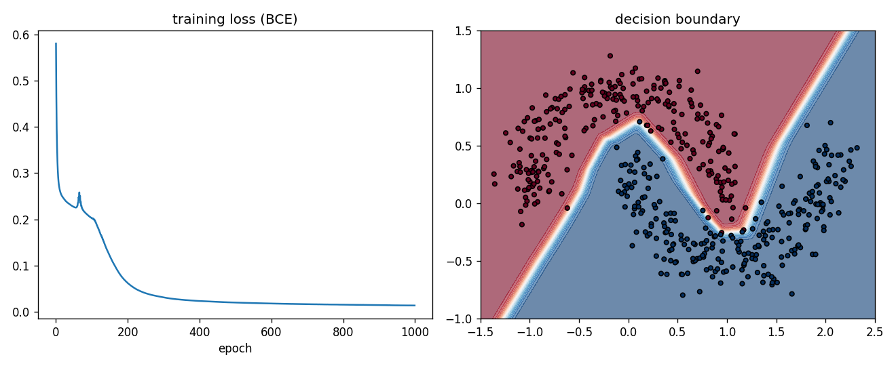

# minitorch-from-scratch

A tiny deep learning framework written with **Python and NumPy only**, built to understand what PyTorch does behind `loss.backward()`.

It has a `Tensor` with reverse-mode automatic differentiation, a `Linear` layer, an `MLP`, two loss functions and an SGD optimizer: enough to train a small neural network from scratch.



## Files

| File | What it does |
| --- | --- |
| `tensor.py` | `Tensor` class: stores data + gradient, records the computation graph, and runs backpropagation |
| `nn.py` | `Linear` layer, `MLP`, `mse_loss`, `bce_loss` |
| `optim.py` | `SGD` optimizer (`step`, `zero_grad`) |
| `data.py` | `make_moons`, a small 2D toy dataset written with NumPy |
| `train.py` | trains an MLP on the moons dataset and saves the plot above |
| `gradcheck.py` | checks every gradient against a numerical gradient |
| `compare_pytorch.py` | trains the same network with PyTorch and compares loss and gradients |

## How autograd works here

1. Every operation (`+`, `*`, `@`, `relu`, ...) creates a new `Tensor` and remembers its inputs in `_prev`.
2. It also stores a small `_backward` function containing the local derivative, for example for `out = a * b`:
   `a.grad += b * out.grad` and `b.grad += a * out.grad`.
3. `loss.backward()` sorts the graph topologically, sets `loss.grad = 1`, and calls each `_backward` from the end to the start. This is the chain rule applied node by node.
4. When broadcasting makes an output bigger than an input (e.g. adding the bias `(1, 16)` to `(400, 16)`), `sum_to_shape` sums the gradient back to the input's shape.

Supported operations: `+`, `-`, `*`, `/`, `**` (number power), `@`, `relu`, `sigmoid`, `log`, `sum`, `mean`.

## Usage

```python
from tensor import Tensor
from nn import MLP, bce_loss
from optim import SGD

model = MLP([2, 16, 16, 1])
optimizer = SGD(model.parameters(), lr=0.5)

loss = bce_loss(model.forward(Tensor(X)), Tensor(y))
optimizer.zero_grad()
loss.backward()
optimizer.step()
```

## Results

**Gradient check** (`python gradcheck.py`): for every operation, and for a full 2-layer network with BCE loss, the backward gradients match the central-difference numerical gradient with a maximum difference of about `1e-9`.

**Training** (`python train.py`): an MLP `2 → 16 → 16 → 1` with full-batch SGD (lr 0.5, 1000 epochs) on 500 noisy moon points (400 train / 100 test):

| | |
| --- | --- |
| final training loss | 0.0136 |
| train accuracy | 99.5% |
| test accuracy | 100% |

The moons dataset is simple and the test set is small, so this shows that the framework *works*, not that the model is strong.

**Comparison with PyTorch** (`python compare_pytorch.py`): the same `2 → 16 → 16 → 1` network, starting from identical weights, is trained for 200 SGD steps with both minitorch and PyTorch 2.8. The two runs stay identical up to floating-point rounding:

| | max difference over 200 steps |
| --- | --- |
| loss | 1.9e-16 |
| gradients | 4.6e-16 |

## Limitations

- Only 2D matrix multiplication; no convolution layers.
- Full-batch SGD only (no mini-batches, momentum or Adam yet).
- `**` supports only plain numbers as the exponent.
- Uses float64 for exact comparison with numerical gradients; much slower than PyTorch.

## Run

```bash
pip install -r requirements.txt
python gradcheck.py
python train.py
python compare_pytorch.py
```
